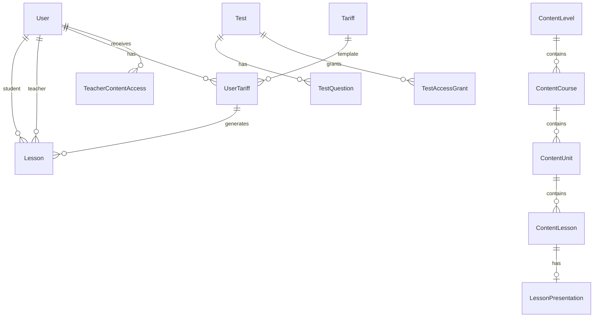

# 05. База даних (Prisma)

← [Технічна](./README.md) · [Головна](../README.md)

Схема: `MainApi/prisma/schema.prisma`. БД: **MySQL**.

## Enum-и

| Enum | Значення | Де використовується |
|------|----------|---------------------|
| `UserPanelRole` | student, teacher | Роль у кабінеті |
| `UserStatus` | active, blocked | Блокування акаунта |
| `AuthPanel` | user, admin | Сесії, події auth |
| `AuthEventType` | LOGIN_SUCCESS, LOGIN_FAILED, … | Audit log |
| `BlockType` | HERO, ABOUT, TARIFFS, RULES, FORM | Legacy page blocks |
| `LeadStatus` | NEW, IN_PROGRESS, DONE | Заявки |
| `TariffPaymentMode` | once, installments | Тариф |
| `UserTariffStatus` | active, scheduled, expired, cancelled | Підписка учня |
| `LessonStatus` | unscheduled, proposed, confirmed, done, missed, admin_skip, frozen, cancelled | Заняття |
| `LessonActor` | teacher, student | Хто запропонував час |
| `ReviewKind` | manual, user | Відгук |
| `ReviewTarget` | school, teacher | Про кого відгук |
| `ContentEntityType` | level, course, unit, lesson | Curriculum + tests |
| `TeacherAccessMode` | readonly, fork | Доступ вчителя |
| `ScheduleRuleKind` | work, busy | Календар |
| `ScheduleRuleScope` | weekly, date, daily | Календар |
| `TestKind` | free, material | Тип тесту |
| `TestAccessDuration` | m1, m5, m15, h1, forever | TTL grant |
| `TestAnswerKind` | choice, write_in | Тип відповіді |
| `TestAttemptStatus` | in_progress, submitted, expired | Спроба |

## Користувачі та auth

### User

Центральна таблиця. Поля:

- `email`, `passwordHash`, `name`, ПІБ, `phone`, `avatarUrl`
- `userRole` — student | teacher (null для admin)
- `teacherId` — зв'язок учень → вчитель
- `isSuperAdmin` — повний доступ без RBAC
- `adminRoleId` — FK на AdminRole
- `status` — active | blocked
- `pendingPassword` — тимчасовий пароль до першого входу
- `activatedAt` — перший успішний login

### AuthSession

Refresh-token сесії: `familyId`, rotation, `panel`, IP, userAgent, `expiresAt`, `revokedAt`.

### AuthEvent

Audit: тип події, panel, path, meta JSON.

### PasswordResetToken

Hash токена, expires, usedAt.

### Permission / AdminRole / AdminRolePermission

RBAC для адмін-панелі. Permission.key — напр. `users.read`.

## CMS і контент сайту

| Model | Призначення |
|-------|-------------|
| `Page` | slug, title |
| `PageSeo` | meta title/description |
| `PageBlock` | Legacy typed blocks (JSON content) |
| `PageSection` | Зв'язок Page ↔ Block (reusable blocks) |
| `Block` + `BlockMeta` | Reusable CMS blocks |
| `Lead` + `LeadCategory` | Заявки з форми |
| `AboutStat` + `AboutStatCategory` | Цифри «Про нас» |
| `Format` | Формати навчання |
| `SchoolRule` | Правила школи |
| `Faq` | FAQ |
| `Review` | Відгуки (manual / user, school / teacher) |
| `IconGroup` + `Icon` | SVG / image / video media |
| `Setting` | key-value JSON (брендинг, SMTP, limits) |

## Тарифи та заняття

### Tariff

Пакет: `lessons`, `price`, `paymentMode`, `installmentCount`, `durationMonths`, `frozenLessonsPerMonth`.

### UserTariff

Підписка учня: status, startsAt, endsAt.

### UserTariffPayment

Частини оплати (installments): partNumber, lessons, amount, paidAt.

### Lesson

Заняття в рамках тарифу:

- `studentId`, `teacherId`, `userTariffId`, `paymentId`
- `number` — номер уроку в пакеті (unique per tariff)
- `status`, `proposedBy`, `startsAt`, `endsAt`
- `contentLessonId` / `teacherLessonId` — прив'язаний матеріал
- `frozenAt`, `reminderSentAt`

## Curriculum

Ієрархія:

```
ContentLevel → ContentCourse → ContentUnit → ContentLesson
```

### TeacherContentAccess

Grant вчителю на entity (level/course/unit/lesson), mode readonly|fork.

### TeacherLesson / TeacherUnit

Fork-версії матеріалів вчителя. `TeacherUnitLesson` — уроки в teacher unit.

### LessonPresentation

PDF/PPTX файл: прив'язаний до ContentLesson або TeacherLesson (unique FK).

## Тести

```
Test → TestQuestion → TestAnswerOption
Test → TestAccessGrant (userId, expiresAt)
Test → TestAttempt → TestAttemptAnswer
```

- `Test.kind`: free (будь-хто з паролем) | material (прив'язаний до entity)
- `Test.entryPassword` — пароль входу
- `Test.randomize` — shuffle питань/опцій
- `orderSnapshot` в attempt — фіксація порядку при старті

## Розклад

### ScheduleRule

Правила work/busy: weekly weekday або конкретна date, startMinute/endMinute.

## Email

| Model | Призначення |
|-------|-------------|
| `MailingLog` | Історія відправок |
| `MailingCronRun` | Запуск cron |
| `MailingTask` | Черга (unique kind+lessonId+userId) |

## Ключові індекси

- `users`: status, adminRoleId, teacherId
- `lessons`: studentId+status, teacherId+status, status+startsAt
- `teacher_content_accesses`: teacherId, entityType+entityId
- `tests`: kind, entityType+entityId
- `test_access_grants`: expiresAt

## Migrations і seeds

При старті API (`runStartup.ts`):

1. DDL migrations у `database/startup/migrations/`
2. Seeds: admin, roles, demo curriculum, tests, home content

Prisma migrate окремо для schema sync; startup patches — для prod hotfixes.

## ER (спрощено)


